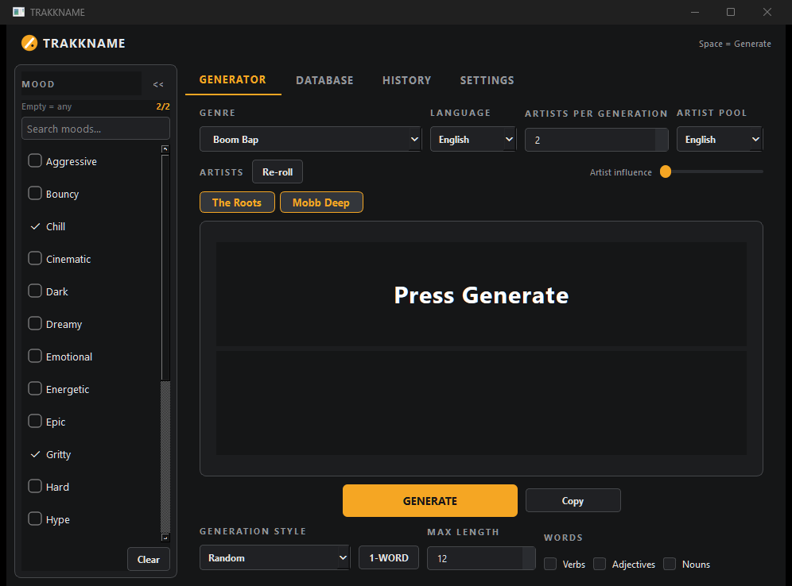

# TRAKKNAME

> **Generate beat titles offline** from genre-weighted artists, bilingual EN/ES word banks and a 20-mood type-beat axis. Built for producers who need a name in five seconds, not a thesaurus.

**[Download for Windows](https://github.com/shardbeats/TRAKKNAME/releases/latest)** · **[Android version](https://github.com/shardbeats/TRAKKNAME-IONIC)** · **[All 6 tools](https://shardbeats.github.io/tools/)** · **[Free beat pack](https://shardbeats.github.io/landing/)**

<!-- Screenshot: save the image as docs/screenshot.png, then uncomment this block
<p align="center"></p>
-->

Free and open source (MIT). Portable ~50 MB exe, no install, no account — your data stays in a local SQLite file.


Local desktop app (Python + PySide6 + SQLite) for generating random beat titles from genre-weighted artists and bilingual word banks. Part of the TRAKK SUITE.

This is the **curation tool**: the vocabulary, artists, moods and patterns curated here feed the mobile rewrite (`trakkname-mobile`) through JSON seed exports.

## Features
- Genre-weighted artist selection (no duplicates per generation)
- **Artist pool selector**: All / En español / English — single indexed `language` predicate per artist (`region` stays as info, editable in Database → Artists); follows the Language combo, overridable
- EN/ES vocabulary: verbs, adjectives, nouns with genre weights + related-genre mixing (70/20/10 configurable)
- **Mood axis**: collapsible sidebar with the 20 most common type-beat moods (multi-select max 2 with FIFO replacement, empty = any, searchable); mood vibe-words get a configurable boost
- 8 generation patterns (4 EN + 4 ES). Single-word titles live **only** in the 1-WORD toggle (never as style options); Spanish adjective agreement; duplicate avoidance window
- Title shown in UPPERCASE, copied in original case; artist preview chips (click to copy); per-title artist re-roll; pool-aware empty texts
- Copy + history (persisted, with genre/language/mood/pool columns), full database CRUD with validation dialogs, JSON import/export + seed reset, persistent settings/window size/sidebar state
- Existing databases migrate themselves on launch (renames, retired patterns, removed single-word patterns, placeholder cleanup) without touching user edits
- Dark compact UI, keyboard-first: `Space` generate, `Ctrl+1` 1-WORD, `Ctrl+C` copy, `Ctrl+H` history, `Ctrl+,` settings, `Ctrl+Shift+D` database

## Requirements
- Python 3.11+
- PySide6 6.6+ (`pip install -r requirements.txt`)
- SQLite (stdlib)
- pytest (only for running the test suite, included in `requirements.txt`)

## Installation / Running
```bat
start.bat      :: creates .venv, installs requirements, launches
run.bat        :: launch with existing .venv
```
Manual: `pip install -r requirements.txt` then `python app\main.py`.

## Portable .exe (no Python needed)
```bat
.venv\Scripts\python.exe build_exe.py          :: tests + windowed one-file exe (~50 MB)
.venv\Scripts\python.exe build_exe.py --console :: console build (diagnostics on clean PCs)
```
Copy `dist\TRAKKNAME.exe` anywhere (USB stick included) and run it — fully
portable, no install. First launch creates `data\` next to the exe
(`trakkname.db`, `settings.json`, `logs\app.log`), migrating any existing
`%APPDATA%` copy once. Opt out with `use_appdata.flag` next to the exe or
`TRAKKNAME_APPDATA=1`; override with `TRAKKNAME_DATA_DIR=<dir>`.

## Database location
- Portable `.exe`: `<exe-dir>\data\trakkname.db` (+ `settings.json`, `logs\app.log`)
- Source runs: `%APPDATA%\TRAKKNAME\trakkname.db` (auto-migrated from the old `BeatNameGenerator` folder on first launch)
- Settings: `settings.json` next to the DB in both modes
- Logs: `logs\app.log` next to the DB in both modes

## Moods (type-beat taxonomy)

Labels stay in English — that is what artists search on YouTube/BeatStars:

Dark, Sad, Aggressive, Hard, Chill, Emotional, Melodic, Energetic, Hype, Bouncy, Smooth, Romantic, Sexy, Dreamy, Melancholy, Cinematic, Epic, Uplifting, Gritty, Mysterious

Each mood links to EN+ES vibe words (`word_moods`, editable per word in Database → Words). Selected moods (max 2) multiply their words' probability by `1 + Mood influence`. History stores the moods per title.

## Enriching vocabulary from kaikki.org (Wiktionary dumps)

`tools/import_kaikki.py` streams `kaikki/kaikki.org-dictionary-{English,Spanish}.jsonl`
(re-download from https://kaikki.org if needed — dumps are ~4 GB, keep the folder out)
without loading them into RAM, keeping only useful words:

- noun/verb/adj only, single alphabetic token, 3–12 chars, no proper nouns
- skips form-of entries (plurals, conjugations), archaic-only, vulgar/offensive
- `affinity` mode (default): keeps a word only if it is a synonym/related/antonym
  of **≥2** words already in the DB (`--min-links 2`) — grows around your aesthetic
- Spanish nouns inherit gender/number from Wiktionary tags (agreement keeps working)
- new words enter as global pool, weight 1.0; backup your DB first (script never overwrites, only inserts)

```bat
python tools/import_kaikki.py --lang es --dry-run
python tools/import_kaikki.py --lang both --mode affinity --limit 3000
```

`tools/make_icon.py` regenerates the app icon from code (amber circle + slash, TRAKKOUT style).

## Import / Export
Database view → Export / Import (JSON incl. genres, artists + weights, words + weights, patterns, history). Reset Seed Data restores factory data (asks first, never silently overwrites).

## Development / Testing
```
python -m pytest tests/ -q
```
43 tests: engine parity (weights, grammar, templates, moods, pools, single-word fallback, pattern migrations), repositories and placeholders. Architecture: `UI → GenerationService → Engine/Repositories → SQLite`. The engine has zero PySide6 dependency (a UI smoke script can run with `QT_QPA_PLATFORM=offscreen`).

Seed data lives in `app/database/seed_data/` (edit lists there, never in `seed/`, which only orchestrates idempotent migrations).

## Project structure
```
app/
  main.py            entry point (dirs, logging, QApplication; DB ensure in database/startup.py)
  models/            enums + pool/language labels
  database/          connection, schema + migrations, startup (ensure_database),
                     seed/ (bootstrap + artists_seed + patterns_seed + moods_seed + placeholders),
                     seed_data/ (genres, artists, moods, patterns, vocabulary),
                     repositories/ (one module per table)
  generator/         weighted_random, grammar (ES agreement), templates,
                     results + artists + context + patterns + renderer, engine (thin facade)
  services/          generation_service, settings_service, import_export
  ui/                main_window, mood_sidebar, history_view,
                     generator_view/ (view + presenter + meta + widgets/result_card),
                     database_view/ (view + crud + io_actions + tabs/genres-artists-words-patterns-moods),
                     dialogs/ (base + genre/artist/word/pattern/mood),
                     settings_view, widgets, theme + style.qss
  utils/             paths (%APPDATA% + legacy migration), logging, text
tests/               43 pytest tests (see above)
tools/               kaikki/ (constants + filters + db + collect + cli), import_kaikki (thin wrapper), make_icon
```

## License
MIT (add LICENSE file as needed).

## TRAKK SUITE

Six free, offline tools for beatmakers. They are independent: install only what you need.

| Tool | What it does |
|---|---|
| [TRAKKSTUDIO](https://github.com/shardbeats/TRAKKSTUDIO) | Organize, convert and normalize in a single window |
| [TRAKKCONVERTER](https://github.com/shardbeats/TRAKKCONVERTER) | Sample libraries → WAV for the Roland SP-404MK2 |
| [TRAKKNORMALIZER](https://github.com/shardbeats/TRAKKNORMALIZER) | Per-clip peak normalization for sample packs |
| **TRAKKNAME** | Beat title generator (EN/ES, 20 moods) |
| [TRAKKOUT](https://github.com/shardbeats/TRAKKOUT) | Beat + artwork → 1080p MP4 for YouTube |
| [TRAKKLICENSE](https://github.com/shardbeats/TRAKKLICENSE) | Beat license contracts as PDF (EN/ES) |

- **Website:** https://shardbeats.github.io/tools/
- **Free beat pack (WAV + stems):** https://shardbeats.github.io/landing/
- **Sound kits:** https://www.beatstars.com/shardbeats/sound-kits

## FAQ

**Is it free?** Yes. MIT licensed, free for personal and commercial use, with no account and no usage limits.

**How does it generate titles?** Genre-weighted artist pools, EN/ES vocabulary (verbs, adjectives, nouns), eight generation patterns and an optional mood axis. Spanish adjective agreement is handled.

**Can I use the titles commercially?** Yes. Titles are generated text, not copyrighted material — no attribution needed.

**Do the titles repeat?** There is a duplicate-avoidance window, and artists never repeat within a single generation.

**Can I edit the word banks and artists?** Yes. The database has full CRUD, plus JSON import/export and a reset to factory seed data.

**Is there an Android version?** Yes — https://github.com/shardbeats/TRAKKNAME-IONIC

**Does it work offline?** Yes. Everything is a local SQLite database.
